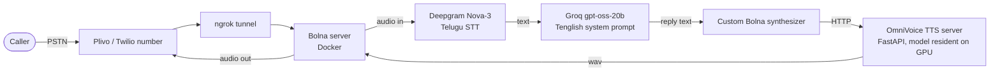

# Telugu Voice Agent (prototype)

An **inbound AI voice agent** that answers phone calls in Telugu + English ("Tenglish"), discovers what the caller needs and books a call with a human. Built on the open-source [Bolna](https://github.com/bolna-ai/bolna) framework, with a **custom synthesizer** that plugs a **self-hosted Telugu TTS server** into it.

> **Status: working prototype, not in production.** Full calls work end to end; TTS latency is the open problem (see *Measured results*).

## Architecture

| Piece | Choice | Why |
|---|---|---|
| Voice framework | Bolna (MIT), patched | Streaming pipeline, telephony servers, barge-in support |
| STT | Deepgram **Nova-3**, `te` | Nova-2 has no Telugu ("No such model/language/tier" 400), Nova-3 works |
| LLM | Groq `gpt-oss-20b` | Fluent Tenglish in a real test call, cheap and fast; a larger "compound" model burned tokens and hit TPM limits |
| TTS | [OmniVoice](https://github.com/k2-fsa/OmniVoice), self-hosted | Telugu voice cloning; a Telugu reference clip keeps synthesis in-language (an English clip caused Telugu leakage) |
| Telephony | Plivo (India number) / Twilio trial | Plivo needs business-domain KYC; Twilio was used first for demos |

## What's in this repo
| Path | What |
|---|---|
| `agent/create_agent.js` | Creates the agent via Bolna's `POST /agent`: Tenglish system prompt, guardrails, Deepgram + Groq + synthesizer config |
| `agent/generate_welcome_audio.py` | Pre-renders the Telugu welcome message so the caller hears it instantly |
| `tts_server/omnivoice_server.py` | FastAPI TTS server: loads the model once, keeps it on the GPU, shares a GPU lock with other jobs, normalises clipping |
| `bolna_patches/omnivoice_synthesizer.py` | The custom Bolna synthesizer that calls the TTS server |
| `bolna_patches/bolna-local-setup.diff` | My changes to Bolna's local setup (single nginx entrypoint so free-tier ngrok's one tunnel works, provider wiring, Docker fixes) |

## Agent behaviour (from the system prompt)
- Opens as "Siddu's AI assistant", never claims to be a human; if asked "are you a bot?" it says yes and uses that as a live demo.
- **Discovery first** (what business, what's painful today), *then* maps the pain to one service, qualifies budget/timeline/decision maker, closes to a **next step** (call with me), never a sale.
- Guardrails: never quotes a final price, never promises a date, never claims work that doesn't exist, admits when unsure and books a callback, stops selling if the caller is angry or asks for a human, replies stay under ~3 sentences (it's voice), and explicit **no-repeat** rules.
- It only handles inbound calls from people who asked to be called. It never cold-calls.

## Measured results
- Multiple real end-to-end test calls with logged transcripts; longest ~4 minutes, coherent discovery flow.
- **Bottleneck: TTS.** The server logs show ~18-20 s to synthesise ~10 s of audio on my GPU (which is also shared with other jobs). That is far too slow for a live conversation, so I did not expose real callers to it.

## Known gaps / next steps
- Make TTS real-time: streaming/chunked synthesis, a smaller or quantised model, or a hosted Telugu TTS as a fallback.
- Structured extraction (lead name, need, budget, next step) is designed but blocked by an upstream `quickstart_server.py` bug (wrong dict nesting for `extraction_details`).
- Add automated latency reporting per stage (ASR / LLM / TTS) after each call.

## Run it (sketch)
1. Clone Bolna, apply `bolna_patches/bolna-local-setup.diff`, copy `omnivoice_synthesizer.py` into `bolna/synthesizer/`.
2. Start `tts_server/omnivoice_server.py` (needs a GPU and your own ~30 s reference clip).
3. `docker compose up` in Bolna's `local_setup`, fill `.env` (Deepgram, Groq, telephony credentials - never commit it).
4. `node agent/create_agent.js` to create the agent, point your telephony number's webhook at the ngrok URL.

## Notes
Secrets, the reference voice clip and call transcripts are intentionally not included. Bolna is MIT-licensed; files here are provided under MIT as well.

Built by [Siddardha Bodavula](https://github.com/bodavulasiddardha-png) - [Portfolio](https://siddu-portfolio-omega.vercel.app)
